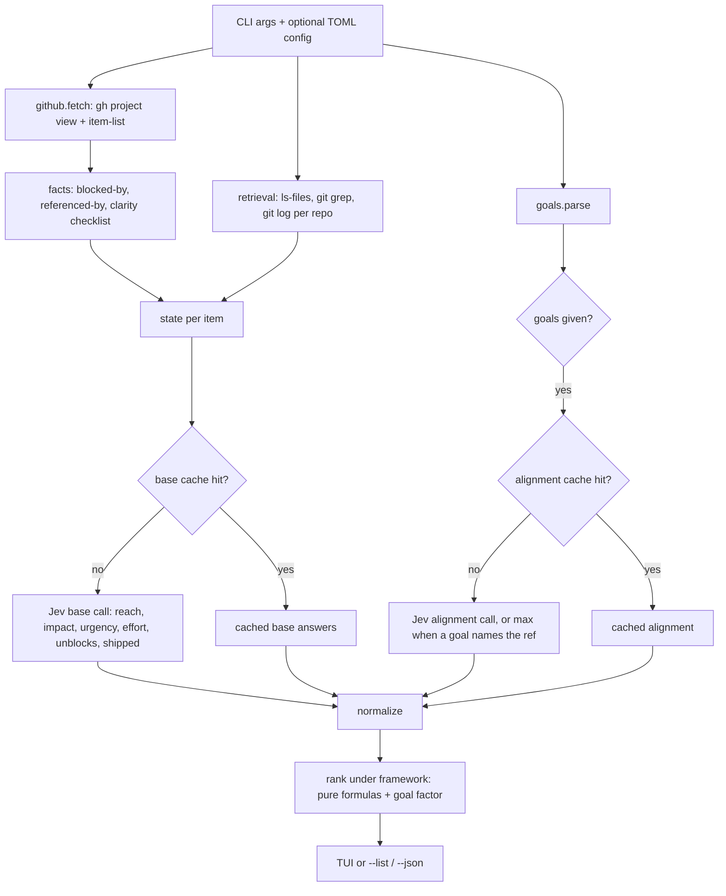

# Standalone Jev Board - Plan

## Goal Capsule

- **Objective:** Anyone can point one command at any GitHub Project board, a list of local codebases and a goals file, and get a ranking of the board's open items that reflects what is already shipped, what each item would touch and what the goals say matters. Re-ranking under a different framework costs no tokens.
- **Means:** Port the prior single-org Jev board script into a Python package with a CLI and a Textual TUI, then add a deterministic codebase retrieval pass, a goals input and an out-of-repo cache (KTD1, KTD3, KTD5, KTD6).
- **Authority:** Product Contract requirements win on behavior. KTDs win on mechanism. Units override neither.
- **Stop conditions:** Stop and report if the TypeSafe SDK cannot express a question the plan needs, or if any path would write to GitHub.
- **Execution profile:** Greenfield repo with no commits. Port first, then improve. Tests run offline with fakes for `gh`, git and Jev.
- **Who finishes:** `ce-work` implements all units. The repo has no remote yet, so shipping ends at local commits.

---

## Product Contract

### Summary

Build `jev-board`, a read-only CLI and TUI that ranks a GitHub Project board's open items with Jev (the TypeSafe System One scorer). It takes the board, `--repos` and `--goals` as inputs. Before scoring, a cheap local pass gathers codebase evidence for each item. Clarity becomes a fact computed in code. Goals feed a separate, cheaply re-asked alignment score. Answers cache under `~/.cache/jev-board/`, written so only changed entries move.

### Problem Frame

The first version lived inside a private vault as a script tied to one organization. Its first real use ranked poorly for three reasons. Clarity scores clustered at 0.7 to 0.9 for every item, so RICE's confidence factor was noise. It had no idea of the team's goals, so an item a goal named as its key unblocker ranked last under both RICE and WSJF. Its cache lived in git and one fix rewrote about 2,000 lines. It also judged effort from issue text alone, and an open issue is not evidence the work is undone.

### Requirements

**Inputs and scope**

- R1. `jev-board <board> --owner <org>` ranks the open items of any GitHub Project board, with no organization, board or audience constants in code.
- R2. `--repos` accepts a comma-separated list of local git checkouts that the retrieval pass searches.
- R3. `--goals` accepts a markdown file of outcomes, each with what it unblocks and the item refs it names.
- R4. The organization description and the reach audience wording are inputs (flag or config file), with neutral defaults.
- R5. The tool is read-only to GitHub: the only `gh` calls are `project view` and `project item-list`.

**Ranking quality**

- R6. Clarity is derived from facts in code, so it separates items with acceptance criteria and concrete references from one-line ideas.
- R7. An item a goal names explicitly ranks above otherwise-equal items under every framework when a goals file is given.
- R8. Effort is judged with codebase evidence: which files and repos an item would touch.
- R9. Items with evidence that the work already shipped are flagged and sorted below open work.
- R10. WSJF is the default framework. RICE, impact/complexity and custom weights remain available.

**Cost and cache**

- R11. Switching framework or weights never calls Jev.
- R12. Editing the goals file re-asks only the alignment question, never the six base dimensions.
- R13. A re-run asks Jev only about items whose text or codebase evidence changed.
- R14. The cache lives at `$XDG_CACHE_HOME/jev-board/` (default `~/.cache/jev-board/`), outside any repo.
- R15. Cache writes are stable: sorted keys, untouched entries byte-identical, no write when nothing changed.

**Surfaces**

- R16. A Textual TUI keeps the prior version's interaction: framework switch, impact×effort map, duel, custom weights, open in browser, re-fetch, re-ask.
- R17. A plain output mode (`--list`, `--json`) prints the ranking without the TUI.
- R18. The TypeSafe key is read from `TYPESAFE_API_KEY`, then from an env file whose path is configurable. No key is stored in the repo.

### Key Decisions

- **Read-only to GitHub** (session-settled: user-directed, chosen over moving or editing board items: board mutation belongs in a different workflow). Governs R5.
- **Cache outside any repo** (session-settled: user-directed, chosen over an in-repo cache: the in-git cache produced ~2,000-line diffs per fix). Governs R14, R15.
- **Generic inputs, no org constants** (session-settled: user-directed, chosen over hardcoded org and board constants: the tool should point at any board). Governs R1, R4.
- **Goals are an input file, not a dependency** (session-settled: user-directed, chosen over importing goals from another system: keeps the tool standalone, and other systems can generate the file). Governs R3, R7, R12.
- **Codebases are an input** (session-settled: user-directed, chosen over scoring effort from issue text alone: an open issue is not evidence the work is undone). Governs R2, R8, R9.
- **WSJF by default** because it read closer to the team's actual week than RICE on first use. Governs R10.

### Scope Boundaries

- Moving, labeling or commenting on board items is out of scope (R5).
- Cloning remote repos is out of scope. `--repos` takes local checkouts only.
- Calling GitHub's PR or search APIs for shipped evidence is out of scope. Local `git log` is the evidence source, which keeps the retrieval pass offline and free. Teams that link issues only from PR bodies leave no ref in git history, so shipped detection misses their work. If that proves common, a read-only PR lookup would need R5 widened first.
- Considered and not built: an `--offline` mode that ranks without calling `gh`. Fetching the board is cheap and keeps item state honest. Revisit if fetch latency becomes the bottleneck.
- Considered and not built: cache pruning of items that left the board. Stale entries are small and harmless. Revisit if cache files grow past a few MB.

#### Deferred to Follow-Up Work

- A goals-file exporter in the systems that track goals. This repo only defines and documents the format.
- Removing the prior script from its old home once this tool runs.

### Success Criteria

- On a board where a goal names an item as its unblocker, that item lands in the top third under WSJF.
- Clarity values across a real board span at least 0.4 between the lowest and highest items.
- A second run with no board or repo changes asks Jev about zero items and does not rewrite the cache file.

---

## Planning Contract

### Key Technical Decisions

- KTD1. **Package layout with a small module per concern.** `jev_board/` holds `config`, `typesafe`, `github`, `cache`, `retrieval`, `goals`, `scoring`, `cli` and `tui`. The prior version had two files with module-level constants. Splitting by concern lets each be tested with fakes and removes the constants R1 forbids.
- KTD2. **Port the scoring core, keep its shape.** Jev answers once per item. Frameworks stay pure functions over normalized 0 to 1 dimensions. Quadrants stay relative to the board's medians. The six dimensions stay reach, impact, urgency, effort, clarity and unblocks (session-settled: user-approved, chosen over rescoring per framework: switching frameworks should cost zero tokens). Governs R11.
- KTD3. **Clarity is computed, not asked.** Clarity stays one of the six dimensions and keeps its role in every formula (KTD2). Only its source changes. Clarity becomes a weighted checklist over facts: acceptance criteria present (a task list, an "Acceptance" or "Done when" heading), a `Blocked by:` line, concrete references that resolve in `--repos`, and enough body to act on. Jev no longer scores clarity, which also saves tokens. Exact weights are tuned during implementation against the success criterion. Serves R6.
- KTD4. **Shipped status is a Jev choice informed by local evidence.** The base call adds a `shipped` choice (`open`, `partly`, `shipped`) beside the five scored dimensions, so it costs no extra call. The state carries commits whose messages mention the item's ref. An item sorts below open work under every framework only when Jev answers `shipped` and the evidence holds at least one mention commit. A `shipped` answer without a mention commit, and any `partly` answer, ranks as open work with a visible flag. Serves R9.
- KTD5. **Retrieval is deterministic and local.** Each repo is read at one ref: its default branch (`origin/HEAD`, falling back to `HEAD`), never the working tree, so evidence does not depend on the checked-out branch or uncommitted edits. For each item, extract candidate paths, backticked identifiers and code-shaped symbols from the title and body. Match paths against the ref's `git ls-files`. Search symbols with one fixed-string `git grep -l` per item per repo against the ref, all symbols passed as patterns, capped. Read each repo's commit log once per run and match refs in Python. A qualified `<repo>#<n>` counts in any repo. A bare `#<n>` counts only in the item's own repo and only after a closing or reference keyword (fixes, closes, resolves, refs, part of). A trailing `(#<n>)` squash-merge suffix never counts, because issues and PRs share one number space. The evidence record holds matched files (capped, sorted), repos touched, symbol hit counts and mention commits. Only the stable part (repos touched, the capped sorted file list, mention-commit shas) enters the Jev state and cache key, so hit-count churn from unrelated commits never re-asks Jev. Hit counts are display-only. Serves R8, R13.
- KTD6. **Goal alignment is a separate cached question.** A seventh score, `alignment` (how directly the item advances a listed goal), is asked in its own call whose cache key combines the item key with a hash of the goals file. Editing goals re-asks only this small question. When a goal names the item's ref, alignment is set to the maximum in code without asking. With no goals file, alignment is not asked and frameworks ignore it. Serves R7, R12. Conflict note against KTD2: the settled decision fixed six scored dimensions. Alignment is a seventh score kept out of the base call, so the decision's intent (score once, frameworks are free) holds. If the six-dimension count was meant literally, alignment can instead fold into impact at rank time with no structural change.
- KTD7. **Frameworks apply a goal factor.** When alignment exists, each framework's value is multiplied by a factor that rises with alignment, so a named item outranks otherwise-equal peers (R7). Custom weights gain an alignment weight. Exact factor shape is tuned during implementation.
- KTD8. **Cache file per owner and board, written atomically and stably.** Path: `$XDG_CACHE_HOME/jev-board/<owner>/board-<n>.json`. Entries keyed by item id, `json.dump` with `sort_keys` and fixed indent, written via temp file and rename, and skipped when the serialized content equals what is on disk. Base answers and alignment answers live in separate sub-keys so a goals edit leaves base entries untouched. Serves R13, R14, R15.
- KTD9. **Key lookup mirrors the prior mechanism with a configurable path.** `TYPESAFE_API_KEY` from the environment, else the first `TYPESAFE_API_KEY=` line in the env file given by `--env-file`, `JEV_BOARD_ENV_FILE`, or `~/.config/jev-board/env`. Missing key exits with a message naming where it looked. Only Jev calls trigger lookup, so cached runs work with no key. Serves R18.
- KTD10. **Config file is optional TOML.** `--config <path>` loads keys matching the flags (`owner`, `repos`, `goals`, `org`, `audience`, `framework`, `env_file`). Flags override the file. `tomllib` is stdlib on Python 3.11+, so no new dependency. Serves R4.
- KTD11. **`jev-board` opens the TUI when stdout is a terminal.** `--list` and `--json` print instead. The TUI imports Textual lazily so plain modes run without it. Serves R16, R17.
- KTD12. **Tests inject fakes, never patch globals.** `github.fetch` takes a runner for `gh`. `scoring.assess` takes a client factory. Retrieval tests build throwaway git repos in a temp directory. Tests need no network and no key.

### High-Level Technical Design

Data flow for one run:



Cache key composition (directional):

```text
base_key      = hash(SCHEMA_VERSION, base question set, board context, item facts, item text, stable retrieval evidence)
alignment_key = hash(base_key, alignment question, goals_file_hash)
```

`SCHEMA_VERSION` is a constant in `scoring.py`, bumped by hand when the shape of the state or the cache entry changes. The serialized question set covers wording changes, including the configured audience and organization text, so editing a question or `--audience` re-asks without a manual bump.

### Output Structure

```text
.gitignore
pyproject.toml
README.md
jev_board/
  __init__.py
  __main__.py
  config.py
  typesafe.py
  github.py
  cache.py
  retrieval.py
  goals.py
  scoring.py
  cli.py
  tui.py
tests/
  conftest.py
  test_config.py
  test_github.py
  test_cache.py
  test_retrieval.py
  test_goals.py
  test_scoring.py
  test_cli.py
examples/
  goals.md
```

### Assumptions

- Goals file format: each `## ` heading is a goal. Optional `outcome:` and `unblocks:` lines follow. Any `<repo>#<n>` ref anywhere in the section counts as named by that goal.
- A repo passed in `--repos` is matched to item refs by the repo name from its `origin` remote, falling back to the directory name.
- The base Jev call can include a `Choice` beside `Score` questions in one `system_one` request, as the prior version's duel already mixes question keys.
- Python 3.11 or newer. Textual is a regular dependency, imported lazily.
- The default audience wording is neutral ("people who use or build the product").

### Sequencing

U1 first. U2, U3, U4 and U5 depend only on U1 and can land in any order. U6 needs U2 through U5. U7 needs U6.

---

## Implementation Units

### U1. Package scaffold, config and key lookup

- **Goal:** An installable `jev_board` package with a `jev-board` entry point, config resolution and TypeSafe key lookup.
- **Requirements:** R1, R4, R18. KTD1, KTD9, KTD10.
- **Dependencies:** none.
- **Files:** `pyproject.toml`, `jev_board/__init__.py`, `jev_board/__main__.py`, `jev_board/config.py`, `jev_board/typesafe.py`, `tests/conftest.py`, `tests/test_config.py`, `.gitignore`.
- **Approach:**
  1. `pyproject.toml` declares `typesafe-sdk` and `textual`, a `pytest` dev group, and the `jev-board` script. Runs under `uv`.
  2. `config.py` resolves a settings object from flags, an optional TOML file and defaults. It also resolves the cache root from `XDG_CACHE_HOME`.
  3. `typesafe.py` re-exports the SDK types, holds the concurrency limit and implements key lookup per KTD9. It never logs or echoes the key.
- **Patterns to follow:** the prior version's `load_key` env-then-file lookup.
- **Test scenarios:**
  - Flag value overrides the same key in the TOML file.
  - Missing TOML file path exits with a clear error.
  - `XDG_CACHE_HOME=/tmp/x` resolves the cache root to `/tmp/x/jev-board`. Unset resolves to `~/.cache/jev-board`.
  - Key present in environment: lookup returns without reading any file.
  - Key absent from environment, present in env file with quotes: lookup sets the env var to the unquoted value.
  - Key absent everywhere: lookup exits, and the message names the env file path but contains no key material.
- **Verification:** `uv run jev-board --help` prints usage. Config tests pass.

### U2. Read-only board fetch

- **Goal:** Fetch a board's open items through `gh` with no org constants.
- **Requirements:** R1, R5. KTD12.
- **Dependencies:** U1.
- **Files:** `jev_board/github.py`, `tests/test_github.py`.
- **Approach:**
  1. Port `fetch`, `ref_of`, the done-status filter, the `Blocked by:` extraction and the referenced-by count.
  2. Take `owner` as a required argument and a runner callable for `gh`, defaulting to `subprocess`.
  3. Keep the `--status` column filter.
- **Patterns to follow:** the prior `fetch` and `gh_json`.
- **Test scenarios:**
  - Items in done-like columns are dropped by default and kept when `--status` names them.
  - A draft item gets ref `draft` and referenced-by 0.
  - `repo#12`, a full issue URL and a same-repo `#12` in other items' bodies each count once toward item `repo#12`. `#123` does not count.
  - The runner receives only `project view` and `project item-list` argument lists.
  - `gh` failure exits with its stderr in the message.
- **Verification:** fetch tests pass using recorded JSON fixtures.

### U3. Stable out-of-repo cache

- **Goal:** A cache store that writes only when content changes and keeps untouched entries byte-identical.
- **Requirements:** R13, R14, R15. KTD8.
- **Dependencies:** U1.
- **Files:** `jev_board/cache.py`, `tests/test_cache.py`.
- **Approach:**
  1. Load returns an empty store on a missing or corrupt file.
  2. Entries hold `base` and `alignment` sub-records, each with its key and answers.
  3. Save serializes with sorted keys and fixed indent, compares to the on-disk text, and writes via temp file plus rename only on difference.
- **Test scenarios:**
  - Save then load round-trips entries.
  - Saving an unchanged store leaves the file's mtime unchanged.
  - Updating one item's alignment changes only that item's lines in a diff of the two files.
  - A corrupt file loads as empty and the next save replaces it.
  - Two owners with the same board number get separate files.
- **Verification:** cache tests pass.

### U4. Codebase retrieval pass

- **Goal:** Deterministic, local evidence per item: files it would touch and commits suggesting it shipped.
- **Requirements:** R2, R8, R9, R13. KTD5.
- **Dependencies:** U1.
- **Files:** `jev_board/retrieval.py`, `tests/test_retrieval.py`.
- **Approach:**
  1. Load each repo once: name from `origin` remote or directory, the default-branch ref and its sha, `git ls-files` at that ref and the commit log at that ref (KTD5).
  2. Extract candidates from title and body: path-like tokens, backticked identifiers, CamelCase and snake_case symbols. Drop stopwords and very short tokens. Cap the candidate count.
  3. Match paths by suffix against tracked files. Search symbols with one `git grep` call per item per repo at the ref, capped.
  4. Match mention commits in Python from the loaded log, by the KTD5 ref rules.
  5. Return a sorted, capped evidence record, with its stable part separated for the cache key.
- **Execution note:** Implement test-first against real temp git repos. Cost and determinism are the risk here, so tests should pin both.
- **Test scenarios:**
  - An item naming `src/app/login.ts` matches that tracked file and reports its repo.
  - An item naming `` `parseGoals` `` finds the file defining it via `git grep`.
  - A commit "Fix login (repo#7)" appears as mention evidence for item `repo#7`, and not for `repo#70`.
  - A commit "fixes #7" in a different repo is not evidence for `repo#7`.
  - In the item's own repo, "closes #7" is evidence for `repo#7`, and a squash-merge subject "Add export (#7)" is not.
  - An item with no code references returns empty evidence.
  - Running twice yields identical evidence records.
  - An unrelated new commit that adds a file containing one of the item's symbols leaves the item's stable evidence unchanged.
  - Uncommitted edits and a checked-out feature branch do not change evidence, which reflects the default branch.
  - A non-git path in `--repos` exits with a message naming it.
- **Verification:** retrieval tests pass. A run on a real repo finishes in seconds for a 100-item board.

### U5. Goals input

- **Goal:** Parse a goals markdown file and expose which goals name which refs.
- **Requirements:** R3, R7. KTD6.
- **Dependencies:** U1.
- **Files:** `jev_board/goals.py`, `examples/goals.md`, `tests/test_goals.py`.
- **Approach:**
  1. Split on `## ` headings. Read `outcome:` and `unblocks:` lines. Collect `<repo>#<n>` refs in each section.
  2. Expose the parsed goals, a ref-to-goals map and a content hash for cache keys.
  3. `examples/goals.md` documents the format by example.
- **Test scenarios:**
  - Two goals with outcome and unblocks lines parse into two records with those fields.
  - A ref in an `unblocks:` line and a ref in a bullet both map to their goal.
  - A file with no headings parses as zero goals without error.
  - Whitespace-only edits change the hash. Identical content gives an identical hash.
- **Verification:** goals tests pass.

### U6. Scoring, clarity facts, alignment and frameworks

- **Goal:** Assess items with Jev using cached answers, compute clarity in code, add alignment and shipped, and rank under each framework.
- **Requirements:** R6, R7, R9, R10, R11, R12, R13. KTD2, KTD3, KTD4, KTD6, KTD7, KTD12.
- **Dependencies:** U2, U3, U4, U5.
- **Files:** `jev_board/scoring.py`, `tests/test_scoring.py`.
- **Approach:**
  1. Port the dimension questions, rewriting reach to use the configured audience and the board context to use the configured organization description.
  2. Drop clarity from the Jev question set. Compute it with the fact checklist.
  3. Add the `shipped` choice to the base call and the codebase evidence to the base state.
  4. Add the alignment question in its own call when goals exist. Set alignment to max in code for named refs.
  5. Port `rank`, `medians`, `quadrant` and `duel`. Apply the goal factor and the shipped demotion inside `rank`. Default framework is WSJF.
  6. `assess` takes a client factory and reports items asked and input tokens for base and alignment separately.
- **Patterns to follow:** the prior `assess`, `_ask`, `rank` and `duel`, including both-orders duel asking.
- **Test scenarios:**
  - Port the prior framework tests: low effort wins under every framework, RICE rewards clarity while WSJF ignores it, custom weights flip order, unassessed items are left out, quadrants are relative to the board.
  - An item with a task list, a `Blocked by:` line and resolved file references scores clarity at least 0.4 higher than a one-line item.
  - With goals naming item B, B outranks an otherwise-identical item A under RICE, IC, WSJF and custom.
  - On a synthetic 12-item board where a goal-named item has below-median base scores, that item lands in the top third under WSJF. Tune the KTD7 factor against this test.
  - Without a goals file, no alignment call is made and rankings equal the no-goal formulas.
  - An item answered `shipped` with a mention commit ranks below every open item.
  - An item answered `shipped` with no mention commit, or answered `partly`, is flagged but ranks as open work.
  - Changing `--audience` re-asks every base item.
  - Second `assess` with unchanged items makes zero client calls.
  - Changing the goals file makes alignment calls only, and base cache entries are unchanged.
  - Changing one item's evidence re-asks only that item.
  - `rank` called with each framework never touches the client.
- **Verification:** scoring tests pass with a fake client that records calls.

### U7. CLI, TUI and README

- **Goal:** The `jev-board` command: TUI on a terminal, plain ranking with `--list` or `--json`, documented.
- **Requirements:** R10, R16, R17. KTD11.
- **Dependencies:** U6.
- **Files:** `jev_board/cli.py`, `jev_board/tui.py`, `README.md`, `tests/test_cli.py`.
- **Approach:**
  1. `cli.py` parses board, `--owner`, `--repos`, `--goals`, `--status`, `--framework`, `--org`, `--audience`, `--config`, `--env-file`, `--refresh`, `--list` and `--json`, then dispatches.
  2. Port the TUI. Show codebase evidence, matched goals and the shipped flag in the detail pane. Replace the hardcoded ref-prefix strip with stripping the longest prefix shared by all repo names on the board. Open URLs with `webbrowser`.
  3. Add alignment to the custom-weight row.
  4. README covers install with `uv`, usage, the goals format, the cache location, key lookup and the read-only guarantee.
- **Test scenarios:**
  - `--json` with fake fetch and fake client prints ranked records with rank, ref, title, status, value, norm and shipped.
  - `--list` prints the header line with asked and cached counts, then one row per item.
  - Missing `--owner` with no config exits with usage.
  - Non-terminal stdout without `--list` or `--json` falls back to the list output.
- **Verification:** CLI tests pass. With a real key, `uv run jev-board <n> --owner <org> --repos <path> --goals examples/goals.md --list` ranks a real board, and the TUI launches.

---

## Verification Contract

| Gate | Command | Applies to |
|---|---|---|
| Unit tests | `uv run pytest` | All units |
| Entry point | `uv run jev-board --help` | U1, U7 |
| Read-only check | `grep -rn '"gh"' jev_board/` shows only the fetch runner, whose tests pin `project view` and `project item-list` | U2 |
| Live smoke (optional, needs key and `gh` auth) | `uv run jev-board <n> --owner <org> --repos <path> --goals examples/goals.md --list`, run twice, second run reports 0 asked | U6, U7 |

## Definition of Done

- Every unit's test scenarios exist and pass under `uv run pytest` with no network and no key.
- No organization, board number or audience string is hardcoded outside defaults that are neutral.
- No reference to the prior script's location appears anywhere in the repo.
- The cache never writes inside the working tree.
- No abandoned-attempt code or unused modules remain in the diff.
